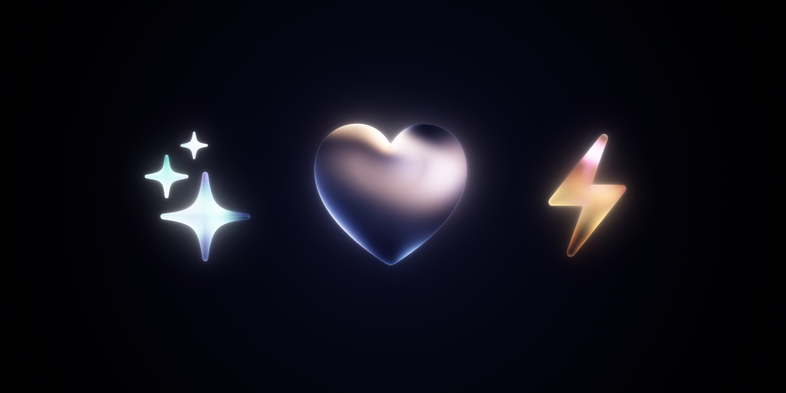
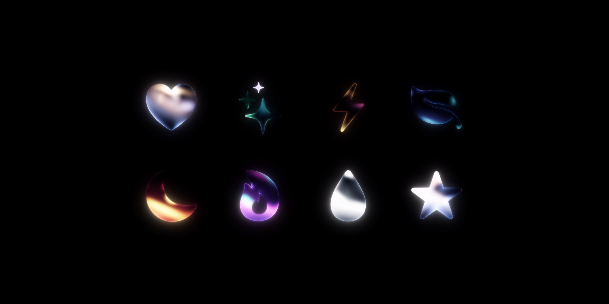
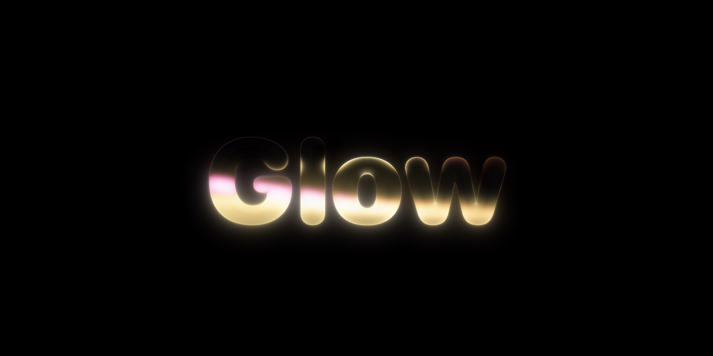
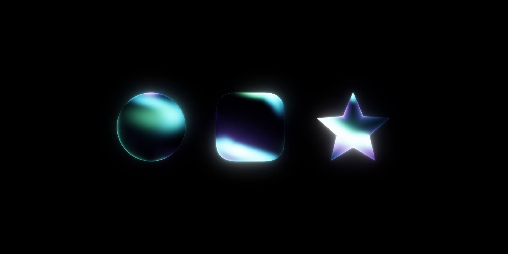
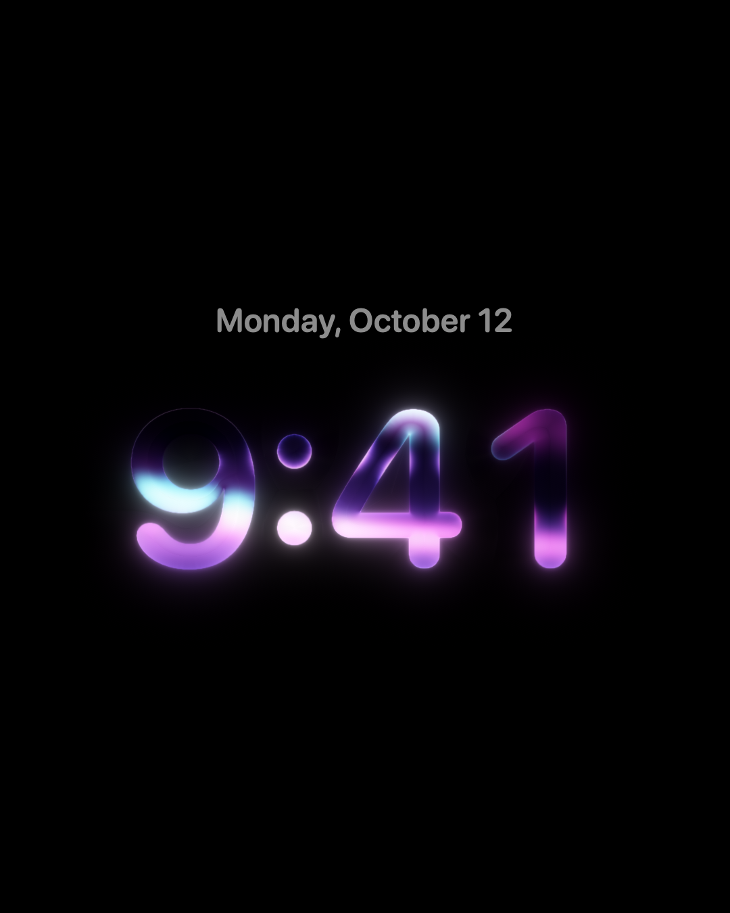
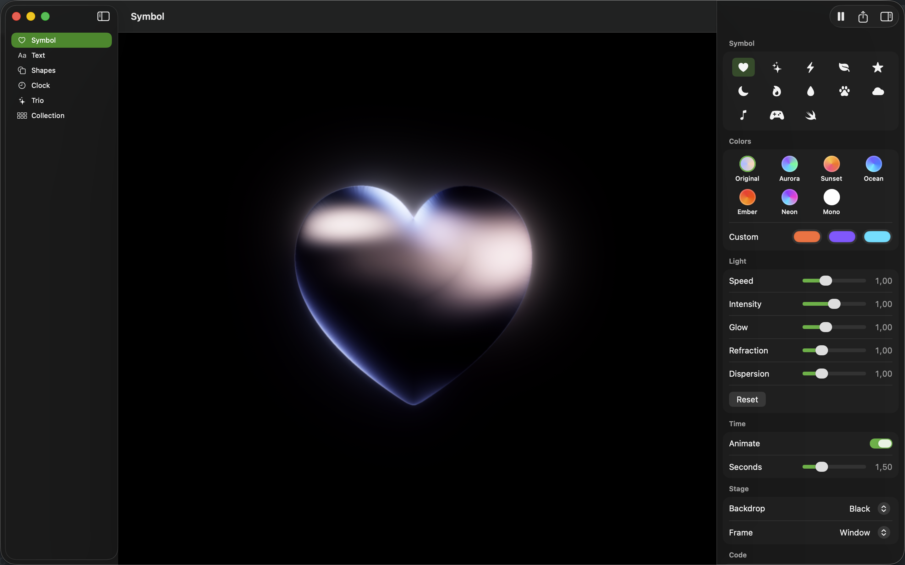

<h1 align="center">GlassGlow</h1>

<h3 align="center">Light moving through glass, on any SwiftUI view.</h3>

<p align="center">
  
</p>

GlassGlow turns any SwiftUI view into glass with light sweeping through it. The shape is the view's alpha: an SF Symbol, text, a `Shape`, an image or a whole composition. The glass refracts and splits the light at its edge, and a soft halo spills around it. One modifier, rendered in Metal, on iOS, iPadOS, macOS, tvOS and visionOS.

```swift
import GlassGlow

Image(systemName: "heart.fill")
    .resizable()
    .scaledToFit()
    .frame(width: 240, height: 240)
    .glassGlow()
```

The view keeps its layout. The halo draws outside the view's frame and does not take touches, so the modifier drops into an existing screen without moving anything.

## Pick the colours

```swift
Text("Glow")
    .font(.system(size: 120, weight: .black, design: .rounded))
    .glassGlow(.sunset)

Circle()
    .frame(width: 200, height: 200)
    .glassGlow(GlassGlowPalette(.pink, .orange, .cyan), speed: 0.8)
```

Ten lights move through the glass. A palette tints them in order and wraps around, so one colour tints them all and three colours alternate. Each light keeps its brightness; only its hue changes. The presets are `.original` (warm and cool whites), `.aurora`, `.sunset`, `.ocean`, `.ember`, `.neon` and `.mono`.

<p align="center">
  
</p>

## Tune the light

`GlassGlowStyle` holds the palette and five multipliers of the original look. At 1 each part looks as designed, and 0 turns it off.

```swift
let style = GlassGlowStyle(
    palette: .aurora,
    speed: 1.5,       // 1 loops every 6 seconds
    intensity: 1.2,   // brightness of the whole effect
    glow: 2,          // strength of the halo
    refraction: 1,    // how far the edge bends the light
    dispersion: 2     // colour split along the edge
)

Image(systemName: "sparkles").glassGlow(style)
```

`time:` freezes the light at a moment of the loop, which is useful for scrubbing, for static screens and for tests:

```swift
RoundedRectangle(cornerRadius: 40).glassGlow(.ocean, time: 2.5)
```

## Any shape

Text works like any other view, and wide shapes stretch the light so it reaches both ends. Shapes take their fill as the alpha, so `Circle()`, `RoundedRectangle` and your own `Shape` types all work.

<p align="center">
  
  
</p>

<p align="center">
  
</p>

## Export images

The live effect is a Metal view, which `ImageRenderer` cannot capture. Add `glassGlowSnapshot(at:)` to the view you render, and every `glassGlow` inside it draws as a still image at that time:

```swift
let card = MyCard().glassGlowSnapshot(at: 2)
let renderer = ImageRenderer(content: card)
renderer.scale = 2
let image = renderer.cgImage
```

`GlassGlowRenderer` renders one view or an alpha mask directly:

```swift
let renderer = try GlassGlowRenderer()
let image = renderer.image(of: Image(systemName: "bolt.fill").resizable(),
                           size: CGSize(width: 200, height: 200),
                           style: GlassGlowStyle(palette: .ember),
                           time: 1)
```

The image is the view's size plus `GlassGlowRenderer.margin(for:)` on every side for the halo, with premultiplied alpha.

## Demo app

`Demo/GlassGlowDemo.xcodeproj` is a macOS app for trying the effect and making images for posts. Pick a scene (a symbol, your own text, shapes, a clock, a collection), set the palette and the light, freeze a moment, and export a PNG at README, square, portrait, story or landscape size. The inspector shows the Swift for what is on the stage, ready to copy.

<p align="center">
  
</p>

The app also renders the images in this README without opening a window:

```sh
GlassGlowDemo.app/Contents/MacOS/GlassGlowDemo --render-assets <folder>
```

The project is generated with [XcodeGen](https://github.com/yonaskolb/XcodeGen) from `Demo/project.yml`.

## How it works

1. The view is drawn to an alpha mask with `ImageRenderer`, with room around it for the halo.
2. A jump-flood pass turns the mask into a signed distance field. It runs again only when the mask changes.
3. Each frame, a compute kernel shades the glass: ten moving lights, the depth from the distance field, refraction and colour split near the edge, and a thin rim.
4. The lit glass is blurred at three radii on its mip chain for the halo, and composed into the view.

All lengths are relative to the shape's height, so the look is the same at every size. The light paths loop every 6 seconds.

## Install

Swift Package Manager:

```swift
dependencies: [
    .package(url: "https://github.com/InsaneArts/glassglow", from: "0.1.0"),
]
```

Requires iOS 17, macOS 14, tvOS 17 or visionOS 1, and a Metal GPU. Without Metal, `glassGlow` shows the view unchanged.

GlassGlow is also a component of [ShadersKit](https://github.com/InsaneArts/shaderskit), where it composes with the other shader layers.

## License

MIT. See [LICENSE](LICENSE).
